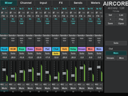

# AIRCORE

声核独立网页皮肤，版本 **0.1.16**。支持语言：en；主题：dark、light。



## 声核与安装

- [声核官网](https://audcore.utae.cn/)
- [下载声核](https://audcore.utae.cn/download/)
- [使用指北](https://audcore.utae.cn/guide/)
- [皮肤开发入口与 SDK](https://audcore.utae.cn/skin-dev/)
- [皮肤开发与发布规范](https://github.com/audcore/audcore-document/blob/main/docs/皮肤发布规范.md)
- [皮肤列表与收录](https://github.com/audcore/audcore-document/blob/main/skins.md)

在启用网页皮肤支持的 Windows x64 声核中打开构建生成的 .skin.audcore，再到皮肤设置选用。本仓库公开源码及独立构建方法，不代表此源码快照已进入官方在线目录；实际下载版本以官方签名列表为准。

## 独立构建

使用 Node.js **24.12.0**，无需 npm 依赖或声核私有仓库。

```sh
git clone https://github.com/audcore/audcore-skin-aircore.git
cd audcore-skin-aircore
node --test tests/page.test.mjs tools/build-package.test.mjs xair.test.mjs
node tools/build-package.mjs . dist
```

输出：`dist/cn.audcore.xair-mixer-v0.1.16.skin.audcore`。这是包含运行清单和全部资源的 ZIP 格式皮肤，不是 EXE。直接在浏览器中打开不提供模拟宿主；开发接口和模拟预览请使用 skin-dev。

## 开发约定

元数据、窗口、语言及构建文件清单只在 manifest.json 维护。README 提供介绍和使用说明。官方构建使用固定提交和受控打包器；包内运行清单自动去除 build 字段。新增依赖或构建规则须重新审核。

当前公开版本是独立源码迁移：调整包内相对引用并移除不随包交付的模拟入口，未覆盖同版本历史官方产物。发布功能变化时必须升版本，禁止用不同内容覆盖已发布版本。未重新启动宿主进行窗口验收。

本仓库是此皮肤的唯一维护来源。宿主保留公共接口、通用测试和内置默认兜底界面。

## 反馈与许可

- [皮肤问题](https://github.com/audcore/audcore-skin-aircore/issues)
- [声核本体问题](https://github.com/audcore/audcore-document/issues)

MIT License；系统字体只按名称引用，不随包分发。

已验证独立打包、资源引用、重复打包字节一致性及上述测试；未重新启动宿主进行窗口验收。布局示意图的可选生成器为 `tools/generate-cover.py`，需要 CairoSVG。
